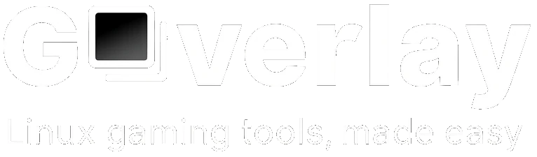
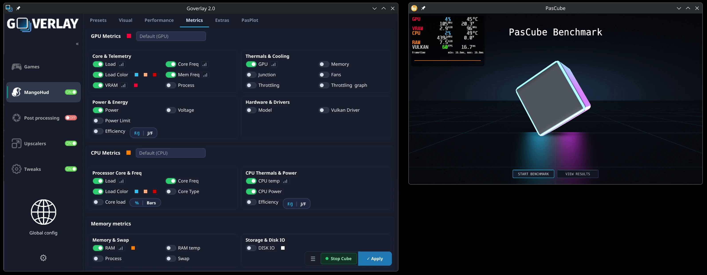
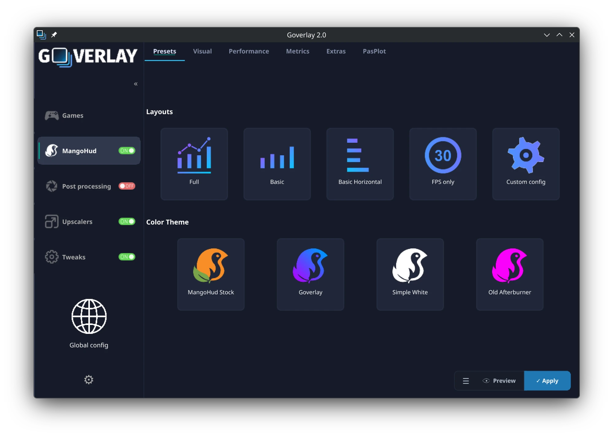
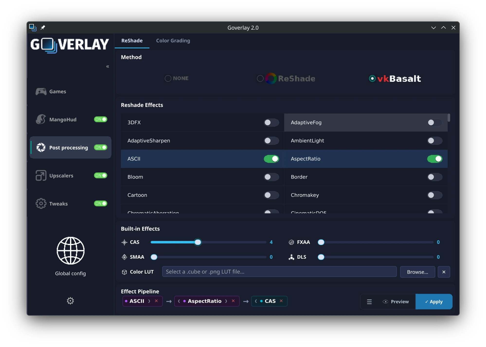
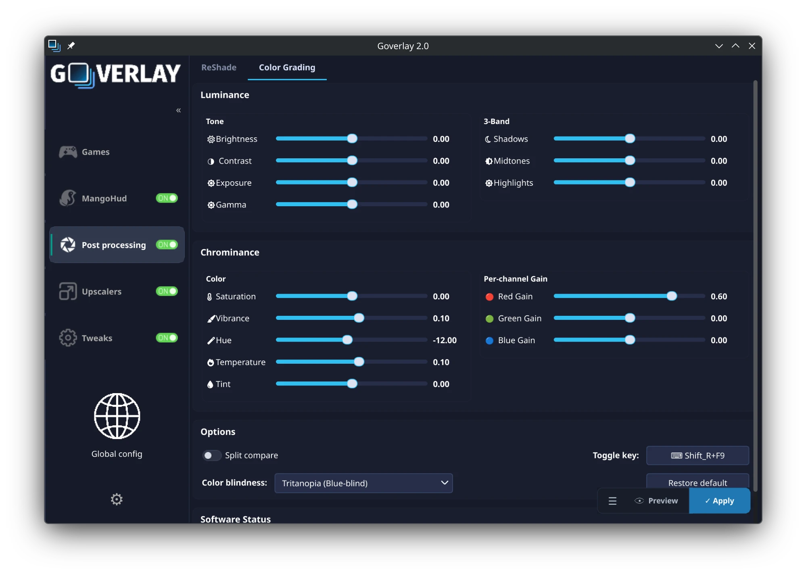
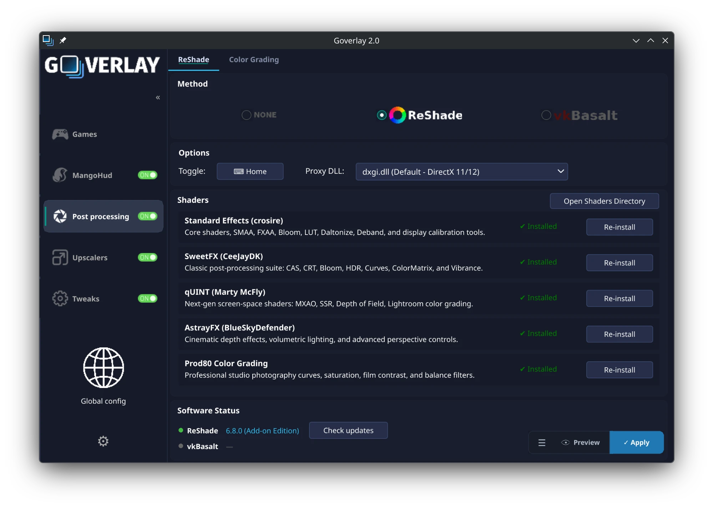
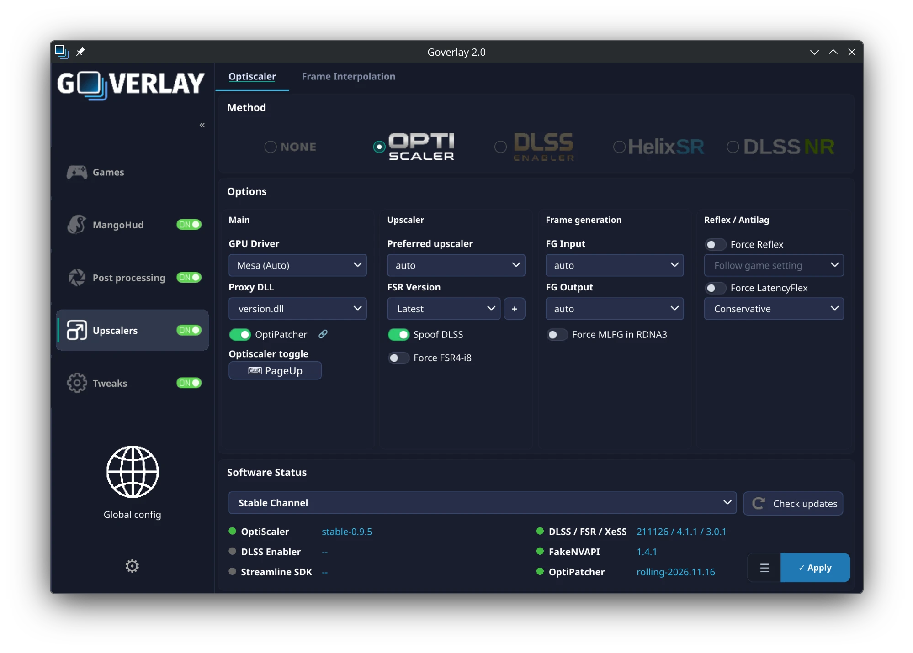
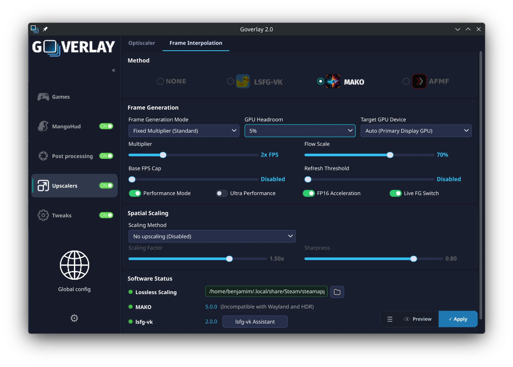
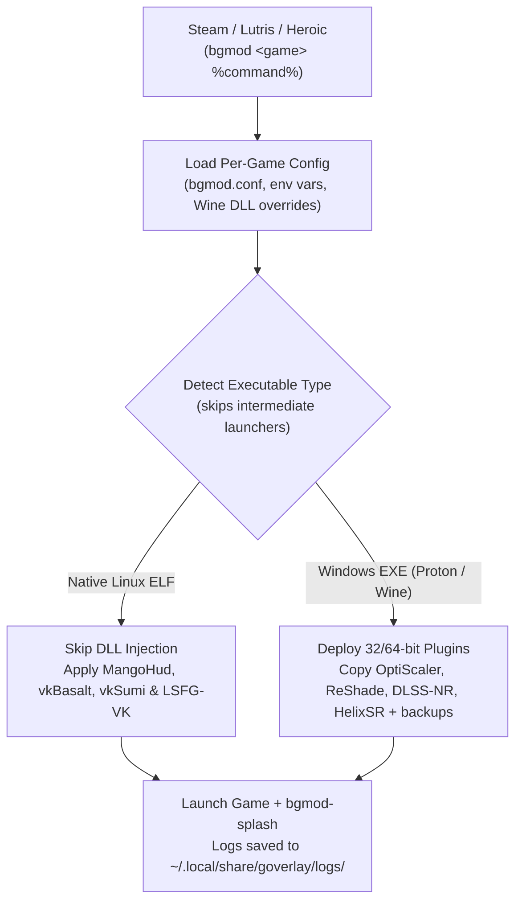

<p align="center">
  
</p>

<p align="center">
  <a href="https://github.com/benjamimgois/goverlay/releases">
    
  </a>
  <a href="https://flathub.org/apps/io.github.benjamimgois.goverlay">
    
  </a>
  <a href="https://aur.archlinux.org/packages/goverlay-git">
    
  </a>
  <a href="https://github.com/benjamimgois/goverlay/releases">
    
  </a>
  <a href="https://github.com/benjamimgois/goverlay/blob/main/LICENSE">
    
  </a>
</p>

---

**Goverlay** is a modern Qt6 GUI for Linux gamers to configure performance overlays, post-processing shaders, upscalers, frame generation, and Proton tweaks—globally or per game—in a few clicks.



---

## Table of Contents

- [Features](#features)
- [Screenshots](#screenshots)
- [Installation](#installation)
- [Prerequisites](#prerequisites)
- [Building from Source](#building-from-source)
- [Architecture & How It Works](#architecture--how-it-works)
- [Credits](#credits)
- [Donations](#donations)

---

## Features

- **Games & Per-Game Profiles:** Auto-detects Steam and non-Steam games (with **Bottles** support in the *Apply Configuration* dialog). Switch between Global and Game Mode with one-click launch command generation (`bgmod ... %command%`) and a non-blocking launch splash (`bgmod-splash`).
- **MangoHud + PasPlot:** Configure presets, layouts, and hardware metrics, and inspect benchmark logs directly in the integrated **PasPlot** viewer with summary cards and metric chips.
- **Unified Post-Processing:** Manage **vkBasalt** (including 3D `.cube`/`.png` LUTs), **vkSumi**, and native **ReShade** (32/64-bit Windows DLL deployment, shader packs, hotkey capture, and `d3dcompiler_47` automation) from a single tab.
- **Upscalers & Frame Generation:** Built-in setup and per-game configuration for **OptiScaler** (including official nightlies, custom FSR 4 builds, and `fakenvapi`), **DLSS-Enabler**, **DLSS-NR 0.0.9** (including RDNA3/4), **HelixSR 3.1**, **Lossless Scaling (`lsfg-vk`)**, **MAKO**, and **AFMF (`afmf-linux`)**.
- **Tweaks:** Streamlined Material Design 3 tab for Proton/Wine overrides, **Controllers**, **GE/ZLUDA** tweaks, custom launch arguments, and environment variables.
- **PasCube Vulkan Preview & Benchmark:** Real-time Vulkan preview powered by PasVulkan, featuring a Ray Tracing benchmark suite, community insights, hardware-isolated comparisons via **PasCubeDB**, and web run submission.

---

## Screenshots

<details>
<summary><strong>Click to view screenshots</strong></summary>

| | |
|---|---|
| <br>*MangoHud presets & integrated PasPlot viewer* | <br>*Unified vkBasalt, vkSumi & ReShade shaders* |
| <br>*OptiScaler, DLSS-NR, HelixSR, LSFG-VK, MAKO & AFMF* | <br>*Tweaks tab (Controllers, GE/ZLUDA & env overrides)* |
| <br>*PasCube benchmark results & PasCubeDB comparisons* | <br>*Game cards & Apply Configuration (Steam / Bottles)* |

</details>

---

## Installation

### Universal Packages

#### AppImage & Native Packages (`amd64` & `aarch64`) (Recommended)
Official **`.deb`** (Debian / Ubuntu), **`.rpm`** (Fedora), **AppImage**, and **tarball** builds for both `amd64` and `aarch64` are provided on the [Releases page](https://github.com/benjamimgois/goverlay/releases):

```bash
chmod +x goverlay*.AppImage
./goverlay*.AppImage
```

#### Flatpak
Install from [Flathub](https://flathub.org/en/apps/io.github.benjamimgois.goverlay) or via terminal (MangoHud and vkBasalt layers are bundled automatically):

```bash
flatpak remote-add --if-not-exists flathub https://dl.flathub.org/repo/flathub.flatpakrepo
flatpak install flathub io.github.benjamimgois.goverlay
```

### Distributions

- **Debian / Ubuntu:** Download the `.deb` package (`amd64` or `aarch64`) from [Releases](https://github.com/benjamimgois/goverlay/releases).
- **Fedora:** Download the `.rpm` package (`amd64` or `aarch64`) from [Releases](https://github.com/benjamimgois/goverlay/releases).
- **Arch & derivatives:** `sudo pacman -S goverlay` (or `yay -S goverlay-git` from AUR)
- **openSUSE:** `sudo zypper install goverlay`
- **Solus:** `sudo eopkg it goverlay`

> [!IMPORTANT]
> **Fedora / Debian / Ubuntu users:** Official distribution repositories often ship outdated versions. Use the official `.deb` / `.rpm` release packages, [AppImage](#appimage--native-packages-amd64--aarch64-recommended), or [Flatpak](#flatpak) instead.
>
> If your distro lacks `libqt6pas`, grab it from [David Bannon’s releases](https://github.com/davidbannon/libqt6pas/releases).

---

## Prerequisites

### Required
- [**`mangohud`**](https://github.com/flightlessmango/MangoHud) — Performance overlay
- [**`qt6pas`**](https://gitlab.com/freepascal.org/lazarus/lazarus/-/tree/main/lcl/interfaces/qt6/cbindings) — Qt6 bindings for Free Pascal / Lazarus
- [**`git`**](https://github.com/git/git) — Clones shader and component repositories
- [**`gamemode`**](https://github.com/FeralInteractive/gamemode) — Feral GameMode daemon
- **Nerd Fonts** — Sidebar and game badge glyphs

### Optional (Managed via Setup Wizard)
Goverlay includes a built-in **Setup Wizard** to install and update optional tools on demand:
- [**`vkBasalt`**](https://github.com/DadSchoorse/vkBasalt) / [**`vksumi`**](https://github.com/reakjra/vkSumi) — Vulkan post-processing
- **ReShade**, **OptiScaler**, **DLSS-NR**, **HelixSR**, **MAKO**, **AFMF**, [**`lsfg-vk`**](https://github.com/PancakeTAS/lsfg-vk) — Post-processing, upscaling, and frame generation
- [**`zenergy`**](https://github.com/BoukeHaarsma23/zenergy) — AMD CPU power metrics in MangoHud
- [**`protontricks`**](https://github.com/Matoking/protontricks) — Proton prefix helper *(native builds only; host-dependent features are hidden in Flatpak)*

---

## Building from Source

Requires **Lazarus IDE** (with Qt6 widgetset), **Qt6 development libraries** (`qt6-base-dev` or equivalent), **`make`**, and **`git`**.

```bash
git clone https://github.com/benjamimgois/goverlay.git
cd goverlay
make
./start_goverlay.sh
```

`make` compiles `goverlay`, `pascube`, `bgmod`, `bgmod-uninstaller`, and `bgmod-splash`. To install system-wide:

```bash
sudo make install
goverlay
```

---

## Architecture & How It Works

<details>
<summary><strong>Technical details: How bgmod works, per-game XDG configs, and tech stack</strong></summary>

### How `bgmod` Works



### Per-Game Config Architecture
When a game is selected, Goverlay switches to **Game Mode** and manages an isolated XDG-compliant config directory per game containing:
- `MangoHud.conf`
- `vkBasalt.conf`
- `vkSumi.conf`
- `OptiScaler.ini`
- `fakenvapi.ini`
- `bgmod.conf` and the `bgmod` wrapper binary

`bgmod` is a compiled Free Pascal binary replacing legacy bash scripts. It keeps game directories anti-cheat safe by storing logs in `/tmp/bgmod.log` and `~/.local/share/goverlay/logs/[Game Name]/`. To remove injected files and restore original backups, run `bgmod-uninstaller`.

### Tech Stack

| Component | Technology |
|---|---|
| Language | Free Pascal (ObjFPC mode) |
| GUI Framework | Lazarus LCL with Qt6 widgetset |
| Build System | `make` (wrapping `lazbuild` & `fpc`) |
| Preview / Benchmark | Integrated Vulkan demo (`pascube`, PasVulkan engine) |
| Game Wrapper | Compiled Free Pascal binaries (`bgmod`, `bgmod-uninstaller`, `bgmod-splash`) |

</details>

---

## Credits

Goverlay builds on the work of the Linux gaming and open-source community:

- **Overlay & Post-Processing:** [MangoHud](https://github.com/flightlessmango/MangoHud) (FlightlessMango), [vkBasalt](https://github.com/DadSchoorse/vkBasalt) (DadSchoorse), [vkSumi](https://github.com/reakjra/vkSumi) (reakjra), [ReShade Shaders](https://github.com/crosire/reshade-shaders)
- **Upscaling & Frame Generation:** [OptiScaler](https://github.com/optiscaler/OptiScaler) & [fakenvapi](https://github.com/optiscaler/fakenvapi), [DLSS-Enabler](https://github.com/artur-graniszewski/DLSS-Enabler) (Artur Graniszewski), [DLSSNR-RDNA3](https://github.com/saaaaaaaaaaaaaaaaaas/DLSSNR-RDNA3), [HelixSR](https://github.com/lonewolf0622/HelixSR), [MAKO](https://github.com/eugeniosegala/MAKO), [afmf-linux](https://github.com/serialexperimentslainnnn/afmf-linux) (serialexperimentslainnnn), [Decky-Framegen](https://github.com/xXJSONDeruloXx/Decky-Framegen) (xXJSONDeruloXx), [fgmod](https://github.com/FakeMichau/fgmod) (FakeMichau)
- **Built with:** [Lazarus IDE](https://www.lazarus-ide.org/) (Free Pascal + Qt6)

---

## Donations

If Goverlay has been useful to you, consider supporting its development ❤️

<a href='https://ko-fi.com/T6T8ERJJ7' target='_blank'></a>
<a href='https://www.paypal.com/cgi-bin/webscr?cmd=_s-xclick&hosted_button_id=Q5EYYEJ5NSJAU&source=url' target='_blank'></a>
